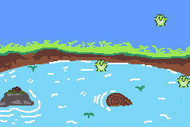

# Bouncers
An exercise to learn about functions and classes.

## Froggy Bounce
    A simple c++ animation where you can add fun little frogs with a simple button and watch them bounce!

[Try it out!](https://samjjcc.github.io/bouncers/)
